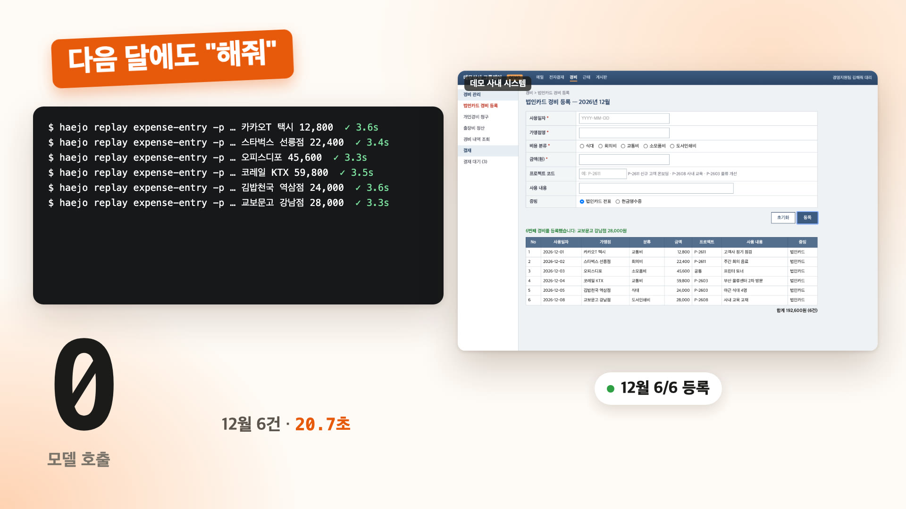
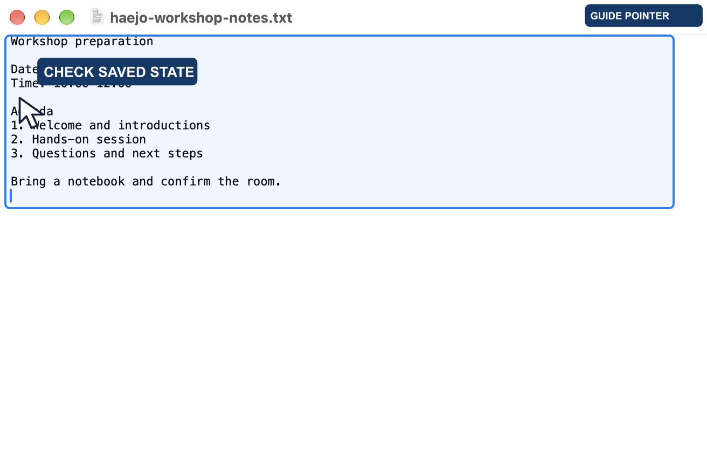
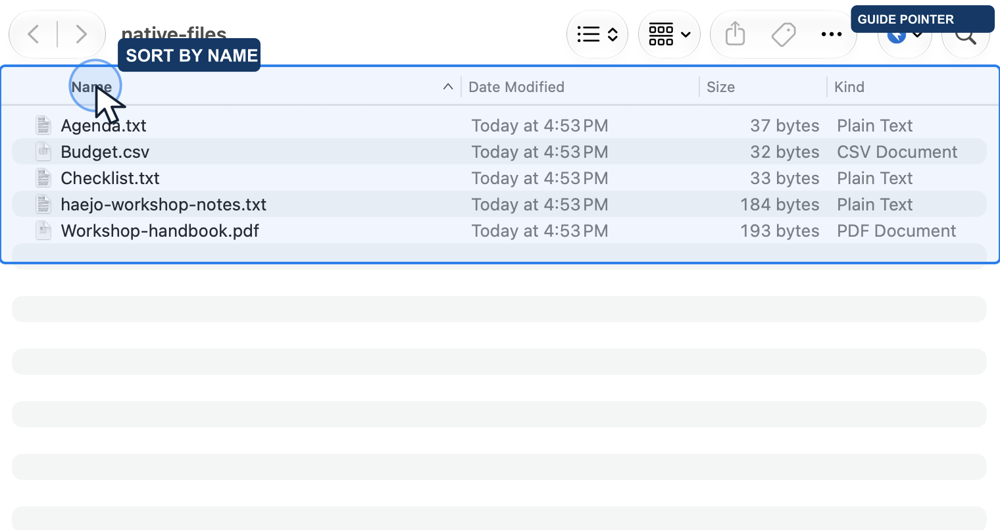
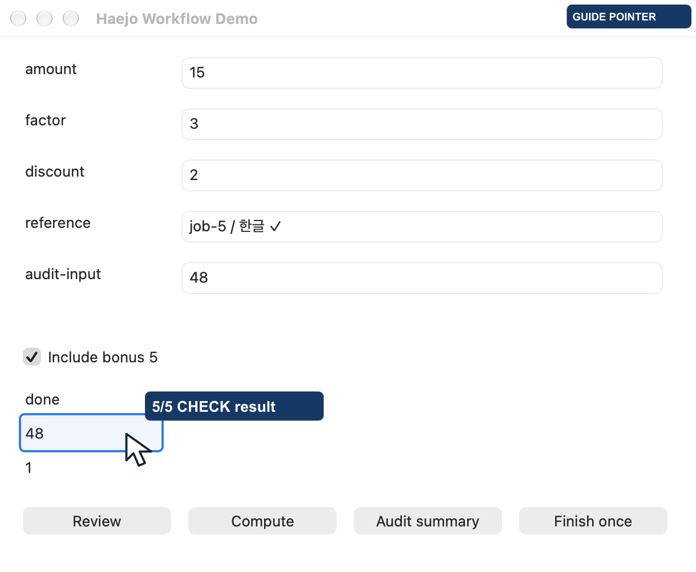
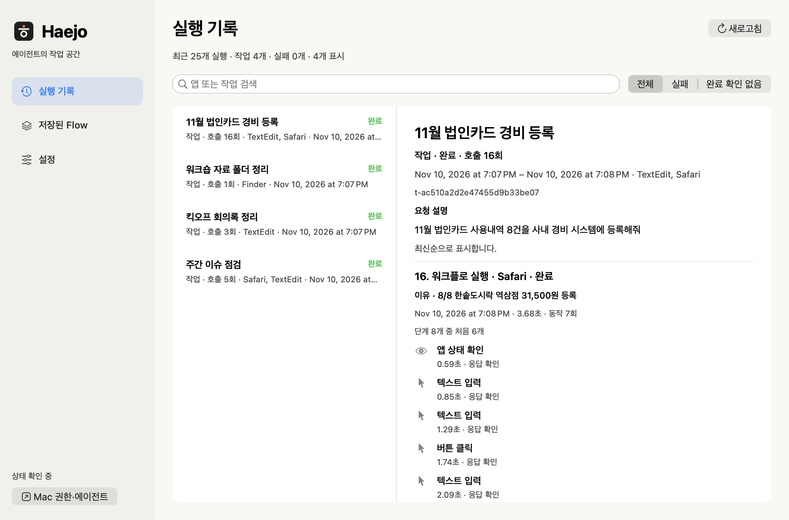

[English](README.md) · **한국어**

<div align="center">


### 말하면 해 줍니다. 확인까지.

**Haejo는 Claude와 Codex가 Mac 앱과 브라우저를 대신 쓰게 해 줍니다.**<br>
앱을 열고, 클릭하고, 입력한 뒤 **결과를 확인해야** 끝났다고 말합니다.<br>
한 번 한 일은 Flow로 저장해, 다음에는 입력값만 바꿔 모델 호출 없이 다시 합니다.<br>
**어떤 앱에서 무엇을 했고 결과가 어땠는지 실행 기록에서 확인하세요.**

[](docs/installation.md)
[](skill/SKILL.md)
[](#getting-started)

[시작하기](#getting-started) &nbsp;·&nbsp; [작동 방식](#how-it-works) &nbsp;·&nbsp; [벤치마크](#benchmarks) &nbsp;·&nbsp; [온보딩 웹사이트](sites/haejo/README.md) &nbsp;·&nbsp; [문서](#documentation)

</div>

> **Tacto에서 이름을 바꿨습니다 (2026-11-09).** v1.0.0-rc.13까지의 출시 후보는 Tacto(`Tacto.app`, `tacto` 명령)로 배포됐고, v1.0.0-rc.39가 Haejo로 나온 첫 릴리스입니다. [업그레이드할 때 바뀌는 점](docs/haejo-branding.md)

<br>

## 실제 앱에서 이런 일을 맡깁니다

[](https://open330.github.io/haejo/#film)

**40초로 보는 Haejo.** API도 없는 사내 경비 시스템에 법인카드 영수증 8건 입력, "해줘". Haejo가 칸마다 바로 입력하고, 모든 호출은 목표·이유와 함께 실행 기록에 남습니다. 한 일을 Flow로 저장하면 다음 달 6건은 모델 호출 없이 다시 입력합니다. 경비 시스템은 데모 화면이고, Safari·TextEdit 화면은 모두 Haejo 호출마다 찍은 실제 캡처입니다. [사이트에서 보기](https://open330.github.io/haejo/#film) · [MP4](sites/haejo/dist/assets/film/haejo-film.ko.mp4)

**실제 앱·웹사이트 8개와 공개 테스트 2개, 총 10개 상황의 실행 영상**을 제공합니다.

| 앱·사이트 | 맡긴 작업과 확인한 결과 | 실제 영상 |
| :--- | :--- | :--- |
| TextEdit | 워크숍 메모 입력 후 별도 저장 검증으로 디스크·문서 내용 일치 확인 | [약 28초](sites/haejo/dist/assets/demos/native-textedit.mp4) |
| Finder | 파일 종류 정렬 → 이름 오름차순 정렬, 파일 5개 확인 | [약 22초](sites/haejo/dist/assets/demos/native-finder.mp4) |
| Google 번역 | 영어 합성 예문 입력 → 한국어 출력 별도 확인 | [약 8초](sites/haejo/dist/assets/demos/browser-translate.mp4) |
| GitHub | 열린 버그만 필터링하고 댓글 많은 순서로 조회 | [약 20초](sites/haejo/dist/assets/demos/browser-github.mp4) |
| UnitConverters.net | 3.5 m → 11.482939633 ft, 별도 계산식과 대조 | [약 11초](sites/haejo/dist/assets/demos/browser-units.mp4) |
| Markdown Live Preview | 기존 예제 앞부분을 계획으로 수정, 제목·목록·굵은 글씨 확인 | [약 9초](sites/haejo/dist/assets/demos/browser-markdown.mp4) |
| Wikipedia | Seoul 검색 후 History 항목 도착 | [약 19초](sites/haejo/dist/assets/demos/browser-wikipedia.mp4) |
| Mac 계산기 | 같은 Flow에 다른 입력값을 넣어 15·12 확인 | [약 14초](sites/haejo/dist/assets/demos/calculator-guided.mp4) |

<a href="sites/haejo/dist/assets/demos/native-textedit.mp4"></a>
<a href="sites/haejo/dist/assets/demos/native-finder.mp4"></a>

공개 테스트 환경의 [상품 확인](sites/haejo/dist/assets/demos/browser-shopping.mp4)과
[폼 작성](sites/haejo/dist/assets/demos/browser-form.mp4)도 제공합니다. 구매·등록은 하지 않았습니다.
아래 브라우저 사례는 **Python BrowserDriver + Flow가 여는 별도 Chromium**에서 촬영했습니다. 이미 열려 있는 Safari 창은 서명된 helper가 창 URL·제목으로 찾아 직접 조작합니다(영상의 경비 입력).

TextEdit 입력은 저장 증거 부족으로 멈춘 뒤 별도 Save의 저장 상태 검증이 통과했습니다.
Google 번역도 입력 전송의 전달 증명과 화면의 한국어 출력 확인을 구분합니다.
Markdown은 나머지 예제가 남는 부분 수정입니다. 모든 사례가 자동으로 끝까지 완료됐다는 주장은 하지 않습니다.
영상에는 설명용 포인터와 촬영 대기가 포함되어 속도·토큰 벤치마크로 사용할 수 없습니다.

[10개 사례의 실제 조건·결과·한계](docs/haejo-everyday-examples-2026-10-15.md) ·
[온보딩 페이지](sites/haejo/README.md)

## 반복 재사용을 확인한 자체 테스트 앱

[](sites/haejo/dist/assets/demos/workflow-guided.mp4)

**실제 앱 창 촬영에 조작 위치를 보여주는 안내 포인터를 추가했습니다.** 자체 macOS 테스트 앱에서 같은 11단계 Flow를 한 단계씩
다른 입력값으로 5회 재생했습니다. 결과 37·46·70·27·48과 작업별 완료 1회를 확인했습니다.

[반복 작업 영상 · 약 21초](sites/haejo/dist/assets/demos/workflow-guided.mp4) ·
[실제 계산기 영상 · 약 14초](sites/haejo/dist/assets/demos/calculator-guided.mp4) ·
[계산기 원본 스크린샷](sites/haejo/dist/assets/demos/calculator-result.png) ·
[촬영 조건과 한계](docs/haejo-film-2026-11-10.md)

포인터·클릭 효과는 설명용으로 추가했으며 실제 시스템 커서 이동 기록이 아닙니다.
[반복 작업 원본](sites/haejo/dist/assets/demos/workflow-replay.mp4) · [계산기 원본](sites/haejo/dist/assets/demos/calculator.mp4)도 제공합니다.
영상은 작성된 Flow의 실행을 보여주며 자연어 작성 과정의 녹화가 아닙니다.
테스트 앱은 상용 업무 앱이 아닙니다. 정상 재생 중 모델 호출은 없지만 최초 작성 비용은 별도입니다.

## 에이전트가 한 일을 직접 확인하세요

**작업은 맡기고, 한 일은 확인하세요.** 요청 하나가 작업 하나로 묶입니다
(`--task new --goal … --why …`). 앱의 실행 기록은 작업마다 요청과 목표, 호출마다
이유와 대상 앱, 결과, 소요 시간을 보여 줍니다. 작업을 검색하고, 실패하거나 완료를
확인하지 못한 실행을 골라 단계별로 확인하세요. 로그 폴더를 찾아갈 필요가 없습니다.
[작업 단위 기록](docs/tasks.md).



기록은 이 Mac에 저장됩니다. 설정에서 자동 저장과 보관 기간(7·30·90일)을
선택할 수 있습니다. 에이전트가 적은 목표와 호출 이유는 남기고, 화면 내용·입력값·
내부 추론은 남기지 않습니다. [실행 기록과 설정 안내](docs/access-logging.md).

앱·사이트별로 한 번 위임하면 에이전트가 macOS Keychain이나
이미 인증된 Bitwarden Vault의 값으로 입력 또는 로그인까지 수행할 수 있습니다.
비밀값은 서명된 도우미로 직접 전달되고, 에이전트에는 결과만 반환됩니다.
앱 설정에서 Vault 연결과 위임 파일의 끌어놓기·검토·저장·취소를 제공합니다. Flow 안의 로그인 단계, 선언한 여러 화면과 선택형 계정 확인도 지원합니다.
[Vault 연결과 위임 수준](skill/references/credentials.md).

`haejo parallel jobs.json --helper --json`은 확인된 창 작업 1–4개를 동시에 실행합니다.
작업마다 서명된 세션과 내용 없는 결과 영수증이 따로 있고, Haejo 메뉴에서 작업별로
중지할 수 있습니다. 같은 앱의 다른 창은 `haejo windows <bundle-id> --helper`로 창 ID를
확인해 따로 다룹니다. 앱 전체 작업은 직렬 처리합니다. [병렬 실행](docs/parallel-execution.md) · [helper 실행](docs/helper-execution.md).

## 에이전트에게 앱 조작을 맡기세요

에이전트가 앱 화면을 읽고 버튼을 누르고 내용을 입력합니다.
이처럼 사용자를 대신해 컴퓨터를 조작하는 기능을 **computer use**라고 부릅니다.
처음에는 에이전트가 앱을 관찰하고 작업 방법을 만듭니다. 그 흐름을 **Flow**로 저장하면,
다음에는 입력값을 바꿔 다시 실행할 수 있습니다. 대상을 찾고, 동작하고, 결과를 확인하는 반복은 Haejo 런타임이 맡습니다.

| 한 번 작성 | 여러 번 실행 | 필요한 순간에 개입 |
| :--- | :--- | :--- |
| Claude·Codex로 재사용할 Flow 작성 | 새 입력값으로 같은 작업 흐름 재생 | 판단이 필요한 단계에만 모델 사용 |
| 작성한 모델에 종속되지 않는 실행 형식 | 정상적인 결정적 재생은 **모델 호출 0회** | 지원되는 실패는 해당 단계만 수리 |

작성·판단·수리에는 모델 비용이 발생합니다. 자동 선택자 수리는 `run`·`batch`에 `--auto-repair codex` 또는 `--auto-repair claude`를 붙여 켭니다.

## 기존 검증 기록

| 맡긴 일 | 앱에서 수행한 동작 | 확인한 결과 |
| :--- | :--- | :--- |
| 텍스트 문서 작성·저장 | TextEdit에서 내용을 편집하고 저장한 파일과 문서 내용을 대조 | Haejo 1회 성공, 최종 내용 일치 |
| 여러 건의 같은 양식 처리 | 값 입력·검토·계산·완료 확인까지 11단계 재생 | 자체 테스트 앱에서 서로 다른 10건 모두 완료, 재생 중 모델 호출 0회 |
| 버튼 변경 후 이어서 실행 | 변경된 계산·검토 버튼을 해당 단계에서 수리하고 계속 실행 | 자체 테스트 앱의 한 작업에서 버튼 2개 수리 후 완료, 모델 호출 2회 |

[TextEdit 실행 기록](docs/benchmark-records.md#정확한-textedit-저장-상태의-실제-비교) ·
[반복·복구 실행 기록](docs/haejo-complex-scenarios-2026-10-14.md) ·
[사례를 보여주는 랜딩페이지](sites/haejo/README.md)

문서 저장은 단회 관측이고, 반복·복구는 개발 버전의 자체 앱에서 검증했습니다.
다른 업무 앱의 호환성·문서 형식·반복 안정성은 별도로 확인해야 합니다.
정해진 문서 작성이나 반복 양식 입력에 적용하려면, 사용하는 앱에서 한 건을 먼저 완료·검증한 뒤 작업 순서를 저장하세요.

서명된 macOS 도우미에서 [같은 창 안의 드래그](docs/native-drag.md)를 지원합니다. 슬라이더·텍스트 선택·캔버스 경로를 AppKit과 실제 TextEdit에서 확인했습니다. 앱 사이의 파일 드롭은 이 경로의 지원 범위에 포함되지 않습니다.

```sh
haejo capture <bundle-id> --helper --window 'Exact title' --output window.png
haejo drag <bundle-id> --helper --window 'Exact title' --from 20 80 --to 220 80
haejo resize <bundle-id> --helper --window 'Exact title' --width 600 --height 360
```

실제 커서 위치에 반응하는 앱(마우스를 올렸을 때의 효과, 커서를 피하는 캐릭터)은 `haejo hover`로 시험합니다. 버튼을 누르지 않고 관찰한 창 안으로 커서를 옮기고, 커서가 그 자리에 있는 동안 창을 캡처할 수 있으며, 끝나면 커서를 원래 자리로 돌려놓습니다. 그 사이 사용자가 마우스를 움직이면 즉시 멈춥니다. [hover 안내](skill/references/hover.md).

```sh
haejo hover <bundle-id> --helper --to 120 80 --hold 1 --capture during.png
```

<a id="how-it-works"></a>

## Make it once. Use it again.

```text
처음     Claude / Codex → 앱 관찰 → Flow 작성·저장
다음     저장한 Flow + 새 입력값 → Haejo 실행·결과 확인
반복     같은 Flow + 다른 입력값 → Haejo 실행·결과 확인
```

보고서 입력, 여러 항목 처리, 같은 앱에서 반복하는 다단계 작업에 재사용할 수 있는 실행 단위를 만듭니다.
Haejo는 실행할 때 대상을 새 관찰에서 찾고 결과 조건을 검사합니다.

<details>
<summary>화면이 바뀌거나 완료 여부가 불확실하면?</summary>

자동 수리는 지원되는 정적 선택자 실패에 대해 필요한 후보만 에이전트에 전달합니다.
확인된 checkpoint 이후부터 재개하며, 이미 완료됐을 수 있는 동작은 그대로 다시 보내지 않습니다.
모든 UI 변화나 crash를 복구하는 기능은 아닙니다. [자동 개입의 지원 범위](docs/haejo-auto-repair-2026-10-14.md)

네이티브 작업 상태와 **현재 작업 중단**은 기존 Haejo 메뉴 막대 아이콘에서 확인합니다. 도우미 아이콘을 별도로 만들지 않으며, Esc로도 중단할 수 있습니다. **설정 → 작업 중 배너 표시**를 끄면 다음 작업부터 우상단 배너를 숨깁니다.

</details>

<a id="getting-started"></a>

## 첫 작업 시작하기

**macOS용 1.0.0-rc.42 정식 출시 후보**입니다(Apple Silicon · macOS 27.0.1에서 확인).

1. [공증된 DMG 다운로드](https://github.com/Open330/haejo/releases/download/v1.0.0-rc.42/Haejo-1.0.0-rc.42-arm64.dmg) ([릴리스 안내와 검증 결과](https://github.com/Open330/haejo/releases/tag/v1.0.0-rc.42))
2. DMG를 열어 `Haejo.app`을 `Applications`로 끌어다 놓고, `Applications`에서 Haejo를 엽니다.
3. **1. Mac 권한**에서 **설정 열기**를 눌러 앱 조작을 **Haejo Helper**에 허용합니다(화면 기록은 **Haejo**에, 선택).
4. 앱을 열면 Claude Code·Codex에 `haejo` 명령과 스킬이 바로 연결됩니다(**2. 에이전트 연결**에서 확인하고, 앱을 옮긴 뒤에는 다시 누르세요).
5. **3. 첫 작업**을 누르면 새 Claude Code·Codex 대화가 TextEdit 환영 메모를 만들고 확인합니다. 언제든 `~/.local/bin/haejo doctor`로 상태를 확인할 수 있습니다.

Tacto를 쓰던 경우도 같은 방법으로 설치합니다. Tacto 데이터는 Haejo 폴더로 옮겨지고, 앱 신원이 바뀌어 macOS 권한 두 가지를 다시 허용해야 합니다. [바뀌는 점](docs/haejo-branding.md)

Haejo는 Dock 아이콘 없이 메뉴 막대에서 실행됩니다. 창을 닫아도 백그라운드에 남고, 메뉴 막대 아이콘에서 다시 열거나 종료할 수 있습니다.

rc.42 DMG는 소스 `e199157`, Python 3.14 기준입니다. 회귀 테스트 3,603개 실패 없음, Apple 공증·Gatekeeper 통과, 같은 번들을 Mac 세 대에 설치해 데이터와 권한을 확인했습니다. **정식 출시 후보이며 아직 승인된 정식 안정 버전이 아닙니다.** 사람이 직접 하는 새 설치, 권한 해제·재부여 반복, 제한 베타([안내](docs/beta-participant-guide.md))가 남아 있습니다. Windows·Intel Mac 빌드는 제공하지 않습니다.
[출시 검증 현황](docs/release-readiness.md) · [설치 범위와 제한](docs/installation.md)

**소스에서 빌드하려면** [uv](https://docs.astral.sh/uv/)(앱 런타임용 Python 3.14를 직접 설치합니다), Xcode Command Line Tools,
Apple 발급 코드 서명 인증서가 필요합니다. 런처·도우미를 같은 팀으로 서명합니다.

```sh
git clone https://github.com/Open330/haejo.git
cd haejo
uv sync
./build.sh
./skill/install.sh
~/.local/bin/haejo doctor
```

`doctor`와 앱의 ‘허용할 앱’ 안내에 따라 **Haejo Helper**의 macOS 권한을 허용한 뒤, Claude 또는 Codex에 요청하세요.

> Haejo 스킬로 계산기에서 12 × 34를 계산하고 결과를 확인해줘.<br>
> 같은 작업을 다시 쓸 수 있도록 매개변수가 있는 Flow로 저장해줘.

저장한 Flow 파일을 실행할 때는:

```sh
~/.local/bin/haejo run flow.json --helper
```

[설치·권한 안내](docs/installation.md) · [Windows(실험적)](docs/windows.md) · [Flow 작성 가이드](docs/recipes.md) · [에이전트 스킬](skill/SKILL.md)

<details>
<summary>설치 문제와 반복 실행</summary>

스킬을 찾지 못하면 에이전트 세션을 다시 열고 `./skill/install.sh --check`로 연결을 확인하세요.
Python 배포 이름은 `haejo-runtime`이고 기본 import는 `haejo`입니다.
Python wheel만으로는 서명된 macOS 런처·helper를 사용할 수 없습니다.
권한용 앱은 **Haejo Helper**(`helper/Haejo Helper.app/Contents/MacOS/HaejoHelper`)이고 실행기는 `launcher/haejo`입니다. 번들 식별자와 서명 요구조건은 `ai.callabo.haejo.*`를 사용합니다.

선택적 Playwright backend는 별도 Chromium 페이지를 사용합니다.

Flow 템플릿 하나로 여러 행을 처리할 때는 작업마다 매개변수 JSON 한 줄을 보냅니다.

```sh
~/.local/bin/haejo batch template.json --helper < jobs.jsonl
~/.local/bin/haejo batch template.json --helper --auto-repair codex < jobs.jsonl
```

</details>

<a id="benchmarks"></a>

## 반복 추론을 줄이면 무엇이 달라질까요?

**개발 버전의 Haejo·Sky 비교에서 전체 입력 토큰 53.5% 감소를 관측했습니다.**
같은 요청 모델·추론 강도와 테스트 앱의 초기 상태를 맞춘 독립 새 대화 3쌍의 결과입니다.

| 지표 | Haejo | Sky |
| :--- | ---: | ---: |
| 작업 성공 | 3/3 | 3/3 |
| 전체 입력 토큰 | **201,447** | 433,312 |
| 평균 시간 | **42.10초** | 46.17초 |

작은 표본의 관측값입니다. 모든 작업에서 더 빠르다는 뜻은 아니며 한 케이스에서는 Sky가 더 빨랐습니다.
[측정 조건과 전체 결과 →](docs/haejo-matched-comparison-2026-10-14.md)

<details>
<summary>캐시·출력·복잡한 Flow 재사용 결과</summary>

2026-10-14 · Codex CLI 0.161.0 · 요청 모델 gpt-6.1-sol · medium.
최초 작성·실행·최종 응답을 포함하고 테스트 준비 시간은 제외했습니다.
실제 serving model·서버 캐시·청구비용은 미확인입니다.

- 캐시 읽기 제외 입력: Haejo 22,119 / Sky 50,592 (**56.3% 감소**).
- 출력: Haejo 1,605 / Sky 1,604.
- 시간 합계: **8.8% 감소**. 이 측정은 10회 재사용 비교가 아닙니다.
- 별도의 11단계 테스트 앱: 정상 작업 **13/13 완료**, 기대 중단 **5/5**, 한 작업에서 버튼 2개 수리.
- 해당 테스트의 정상 10회 반복은 모델 호출 **0회**. 실제 업무 앱 전체의 성공률을 대신하지 않습니다.

[복잡한 시나리오 결과](docs/haejo-complex-scenarios-2026-10-14.md)

</details>

## 먼저 흐름을 살펴보세요

[온보딩 랜딩페이지](https://open330.github.io/haejo/)([소스](sites/haejo/README.md))에서 재생·수리·중단 예시와 설치 안내를 제공합니다.
실제 앱이나 모델을 실행하지 않는 인터랙티브 소개입니다.

```sh
python3 sites/haejo/serve.py
```

`http://127.0.0.1:8787`에서 확인할 수 있습니다.

<a id="documentation"></a>

macOS 설정의 **빠른 실행(helper 유지)**을 켜면 다음 작업의 시작 시간을 줄일 수 있습니다. 기본은 꺼짐이며 유휴 시간은 1–10분입니다. `HAEJO_HELPER_MODE=warm` / `per_command`가 앱 설정보다 우선합니다. 동시 실행은 최대 10초 대기 후 `helper_busy`로 안내합니다. [동작과 측정 범위](docs/helper-execution.md).

## 필요한 문서부터

[설치](docs/installation.md) · [Flow 작성·재생](docs/recipes.md) · [API](docs/api.md) · [지원 기능](docs/capabilities.md) · [에이전트 스킬](skill/SKILL.md)

<details>
<summary><strong>CLI 명령 찾아보기</strong></summary>

주요 명령입니다.

| 목적 | 명령 |
| :--- | :--- |
| 설치·환경 확인 | `haejo doctor` |
| 앱·화면 관찰 | `haejo apps`, `haejo observe`, `haejo menu-state` |
| 자연어·Flow 실행 | `haejo do`, `haejo run`, `haejo replay` |
| Flow 작성·매개변수화 | `haejo compile`, `haejo parameterize` |
| 저장 Flow·후보 관리 | `haejo list`, `haejo show`, `haejo flows`(저장·이름 변경·삭제·입력 편집, 앱의 저장된 Flow 페이지), `haejo candidates`, `haejo promote` |
| 반복·세션·수리 | `haejo batch`, `haejo session`, `haejo repair` |
| 작업·실행 기록 | `haejo task`, `haejo logs` |
| 창·병렬 작업 | `haejo windows`, `haejo activate`, `haejo parallel` |
| 웹·파일 | `haejo open-url`, `haejo web-upload`, `haejo document-attachments` |
| 자격 증명 | `haejo auth` |
| 평가(소스 checkout) | `haejo eval` |

개발용 명령입니다.

| 목적 | 개발용 명령 |
| :--- | :--- |
| VRoid 전용 실험 | `haejo vroid-focus`, `haejo vroid-drag` — `HAEJO_ENABLE_EXPERIMENTAL_FOREGROUND=1`로 별도 빌드한 개발용 진단 경로. 기본 빌드 제외 |

`haejo --help`로 현재 checkout의 명령을 확인하세요.
네이티브 작업은 서명된 런처를 사용하고 필요한 명령에 `--helper`를 지정합니다.

</details>

<details>
<summary><strong>문서 찾아보기</strong></summary>

- [필름과 랜딩 재촬영 (2026-11-10)](docs/haejo-film-2026-11-10.md)
- [작업 단위 기록](docs/tasks.md)
- [사용자가 이미 승인한 동의로 진행하기](docs/approved-consent.md)
- [긴 Flow 대기와 마감 일시정지](docs/flow-wait-until.md)
- [창 병렬 실행](docs/parallel-execution.md)
- [GUI·브랜딩 독립 검토와 수정 결과](docs/haejo-gui-review-2026-10-17.md)
- [로고·시각 아이덴티티](docs/haejo-visual-identity.md)
- [랜딩페이지 개선·검증](docs/haejo-landing-engineering-2026-10-15.md)
- [실제 촬영 영상·스크린샷](docs/haejo-recorded-demos-2026-10-15.md)
- [실제 앱·웹 일상 작업 10개](docs/haejo-everyday-examples-2026-10-15.md)
- [초기 브라우저 사용 예제 3개](docs/haejo-browser-examples-2026-10-15.md)
- [출시 범위·검증 조건과 최종 DMG 검사](docs/release-readiness.md)
- [베타 참여 안내](docs/beta-participant-guide.md)
- [첫 작업 품질 개선·교차 검토](docs/haejo-quality-review-2026-10-19.md)
- [네이티브 서명·기본 빌드·설치 UX 수정 결과](docs/haejo-native-release-fixes-2026-10-16.md)
- [전체 개선 peer 검토와 잔여 출시 제한](docs/haejo-peer-review-2026-10-16.md)
- [Haejo 이름·배포 식별자](docs/haejo-branding.md)
- [Python API](docs/api.md)
- [새 파일 저장의 host receipt](docs/artifact-receipts.md)
- [비교 실행 기록](docs/benchmark-records.md)
- [지원 경로와 검증 범위](docs/capabilities.md)
- [Claude CLI result adapter](docs/claude-adapter.md)
- [전체 목표의 완료 기준과 현재 작업](docs/completion-plan.md)
- [큰 관측값과 이력 조회](docs/context-paging.md)
- [요청과 수신함을 결합한 전송 영수증](docs/delivery-evidence.md)
- [평가 실행과 결과 읽기](docs/evaluation.md)
- [배경 입력의 포커스·캐럿 관측](docs/input-observation.md)
- [권한 받기 UX와 시작 앱 개선](docs/permission-onboarding.md)
- [설치 범위와 실행 경로](docs/installation.md)
- [읽기 전용 메뉴 발견](docs/menu-discovery.md)
- [모델 호출의 시간 예산](docs/model-deadlines.md)
- [Native window image reads](docs/native-visual.md)
- [네이티브 창별 입력의 현재 지원 범위](docs/native-window-input.md)
- [Flow의 자동 에이전트 개입](docs/haejo-auto-repair-2026-10-14.md)
- [복잡한 11단계 작업과 실패 시나리오 검증](docs/haejo-complex-scenarios-2026-10-14.md)
- [같은 요청 조건에서 Haejo·Sky 비교](docs/haejo-matched-comparison-2026-10-14.md)
- [Signed provider 응답](docs/provider-envelope.md)
- [실행 기록에서 워크플로로 — 판단은 필요한 곳에만](docs/recipes.md)
- [Native RTF save receipts](docs/rtf-receipts.md)
- [Native Save panel directory observation](docs/save-directory-observation.md)
- [TextEdit 새 이름 저장의 호스트 증거](docs/textedit-save.md)
- [Browser visual reads and clicks](docs/visual.md)

</details>

---

**Haejo** · Local execution. Reusable computer use.<br>
Release candidate · [MIT License](LICENSE)


<details>
<summary>런타임 개선과 검증 기록</summary>

- [dispatch-journal](docs/dispatch-journal.md)
- [journal-reconciliation](docs/journal-reconciliation.md)
- [menu-readiness](docs/menu-readiness.md)
- [haejo-attended-operation-design](docs/haejo-attended-operation-design.md)
- [haejo-authoring-literal-validation](docs/haejo-authoring-literal-validation.md)
- [haejo-capture-continuation-validation](docs/haejo-capture-continuation-validation.md)
- [haejo-latency-profile-20261019](docs/haejo-latency-profile-20261019.md)
- [haejo-native-matched-validation-20261019](docs/haejo-native-matched-validation-20261019.md)
- [haejo-native-resumption-validation](docs/haejo-native-resumption-validation.md)
- [haejo-provider-paging-validation](docs/haejo-provider-paging-validation.md)
- [haejo-textedit-saved-state-validation](docs/haejo-textedit-saved-state-validation.md)
- [window-preparation-diagnostics](docs/window-preparation-diagnostics.md)
- [Preview 3 런타임 업데이트](docs/runtime-update-2026-10-19.md)

</details>

[자동 접근 로그와 실행 기록](docs/access-logging.md)
