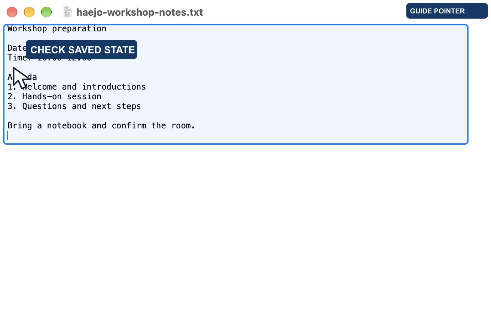
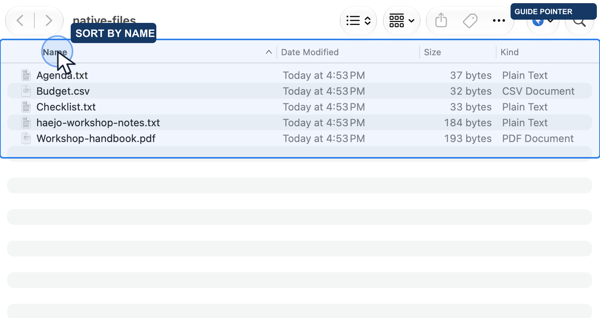
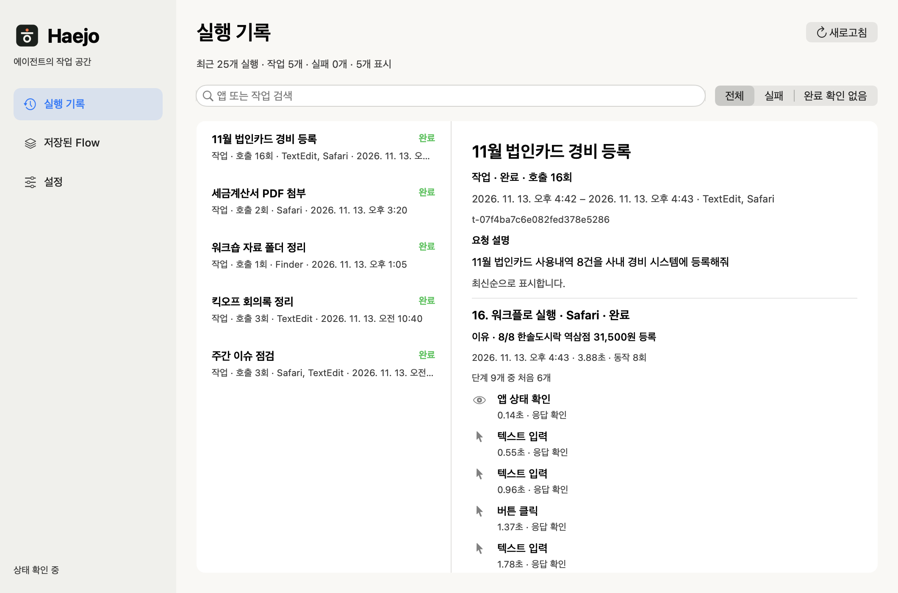
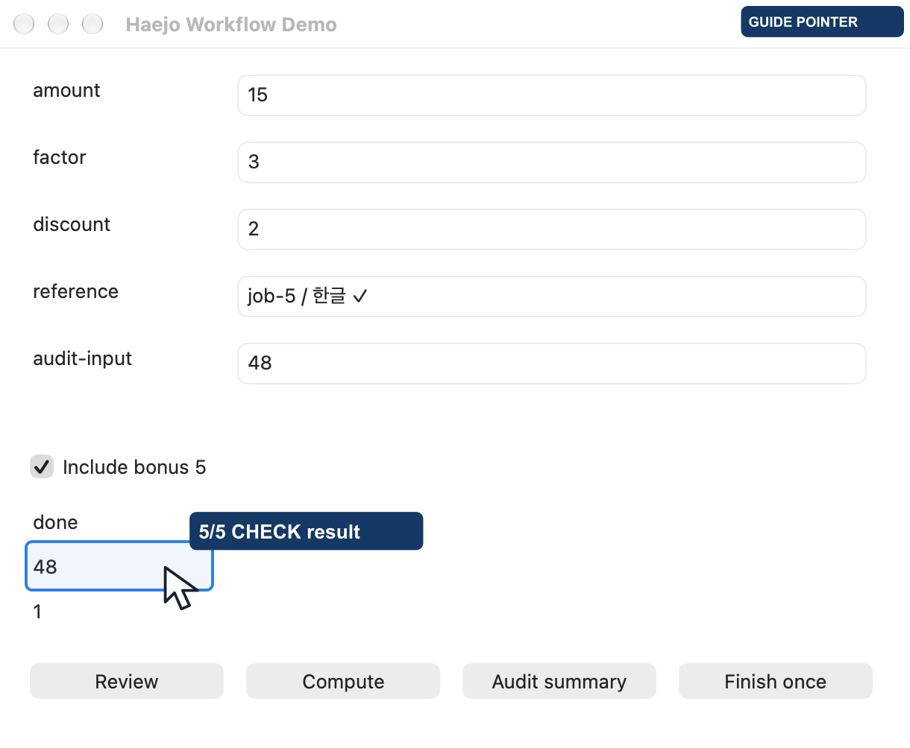

**English** · [한국어](README.ko.md)

<div align="center">


### Ask Haejo to use your apps.

**Haejo lets Claude and Codex use your Mac and browser apps for you.**<br>
It opens apps, clicks and types, and **checks the result** before calling a task done.<br>
It saves the steps as a reusable **Flow**, so next time it runs with new inputs and no model call.<br>
**See which apps it used, what it did, and how each task ended.**

[](docs/installation.md)
[](skill/SKILL.md)
[](#getting-started)

[Release candidate](https://github.com/Open330/tacto/releases/tag/v1.0.0-rc.13) · [How it works](#how-it-works) · [Benchmarks](#benchmarks) · [Documentation](#documentation)

</div>

> **Renamed from Tacto (2026-11-09).** Release candidates up to v1.0.0-rc.13 were published as Tacto (`Tacto.app`, `tacto` command). The next release ships as Haejo. [What changes when you upgrade](docs/haejo-branding.md)

## See it work in real apps

[](sites/haejo/dist/assets/demos/browser-wikipedia.mp4)

An animated preview from an actual recorded run. Click for the full MP4. GitHub's accessibility settings can disable animated-image autoplay.

**Ten recorded scenarios: eight real apps or websites, plus two public test environments.**

| App or site | Task and observed result | Recording |
| :--- | :--- | :--- |
| TextEdit | Write workshop notes; separately verify saved disk contents against the document | [10 sec](sites/haejo/dist/assets/demos/native-textedit.mp4) |
| Finder | Sort five files by kind, then by name | [8 sec](sites/haejo/dist/assets/demos/native-finder.mp4) |
| Google Translate | Enter a synthetic English example; separately check Korean output | [7 sec](sites/haejo/dist/assets/demos/browser-translate.mp4) |
| GitHub | Filter open bugs and sort by comment count | [9 sec](sites/haejo/dist/assets/demos/browser-github.mp4) |
| UnitConverters.net | Convert 3.5 m to 11.482939633 ft; compare with a separate calculation | [9 sec](sites/haejo/dist/assets/demos/browser-units.mp4) |
| Markdown Live Preview | Edit the opening section; check heading, list, and bold text | [18 sec](sites/haejo/dist/assets/demos/browser-markdown.mp4) |
| Wikipedia | Search Seoul and navigate to History | [14 sec](sites/haejo/dist/assets/demos/browser-wikipedia.mp4) |
| Mac Calculator | Replay the same Flow with different inputs; verify 15 and 12 | [14 sec](sites/haejo/dist/assets/demos/calculator-guided.mp4) |

<a href="sites/haejo/dist/assets/demos/native-textedit.mp4"></a>
<a href="sites/haejo/dist/assets/demos/native-finder.mp4"></a>

Also available: [product lookup](sites/haejo/dist/assets/demos/browser-shopping.mp4) and [form filling](sites/haejo/dist/assets/demos/browser-form.mp4) in public test environments. No purchase or registration was submitted.

Browser demos use **Python BrowserDriver + Flow in a separate Chromium instance**, rather than your existing Chrome or Safari tabs. TextEdit stopped when save evidence was insufficient; a separate Save verification then passed. Google Translate's output check is separate from proof of input delivery. The Markdown demo edits only the opening section and leaves other sample content intact.

Recordings include illustrative pointers and capture delays. They show authored Flows executing, not natural-language authoring, and are not speed or token benchmarks. Not every demo completed without intervention. [Conditions, results, and limits](docs/haejo-everyday-examples-2026-10-15.md).

Same-window [drag gestures](docs/native-drag.md) are supported by the signed macOS helper: sliders, text selection and canvas paths, with receiving tests in AppKit and TextEdit. Cross-app file drops are outside this route.

```sh
haejo capture <bundle-id> --helper --window 'Exact title' --output window.png
haejo drag <bundle-id> --helper --window 'Exact title' --from 20 80 --to 220 80
haejo resize <bundle-id> --helper --window 'Exact title' --width 600 --height 360
```

Apps that react to the real cursor (hover effects, a character that avoids it) can be exercised with `haejo hover`: it moves the cursor into the observed window without pressing a button, optionally captures the window while the cursor is there, and puts the cursor back. Moving the mouse yourself stops it. [Hover guide](skill/references/hover.md).

```sh
haejo hover <bundle-id> --helper --to 120 80 --hold 1 --capture during.png
```

## Know what your agent did

**Delegate the work. Inspect the activity.** Haejo's in-app history shows accesses
made through Haejo: the target app, operation, outcome and elapsed time. Search
runs, filter failures or unconfirmed completion, and follow each operation in a
timeline without opening a log directory.



Records stay on this Mac. Settings control automatic logging and 7/30/90-day
retention. Screen content, input values, prompts and internal agent reasoning
are excluded. [Activity history and settings](docs/access-logging.md).

Agents can use a reusable, site/app-scoped credential
delegation to fill fields or complete login from macOS Keychain or an already
authenticated Bitwarden Vault. Values go directly to the signed helper;
the agent receives only the result. Available in rc.11, with in-app Vault management, reusable Flow authentication, declared multi-screen login and optional account checks. [Credential setup and delegation levels](skill/references/credentials.md).

<a id="how-it-works"></a>

## Make it once. Use it again.

```text
First time    Claude / Codex → observe the app → author and save a Flow
Next time     saved Flow + new inputs → Haejo executes and checks results
Repeat        same Flow + different inputs → Haejo executes and checks results
```

This is **computer use**: agents read app interfaces, click controls, and enter information for you. Haejo stores the procedure so the model does not have to reason through every routine step again.

| Author once | Replay with new inputs | Intervene when needed |
| :--- | :--- | :--- |
| Create a Flow with Claude or Codex | Resolve targets from fresh observations and check outcomes | Use a model for judgment or supported repairs |
| Model-independent execution format | **Zero model calls during normal deterministic replay** | Supported repair resumes at the affected step |

Authoring, judgment, and repair still cost model tokens. Automatic selector repair currently belongs to the **development checkout's Codex provider**; it is not included in the packaged release candidate.

<details>
<summary>What if the interface changes or completion is uncertain?</summary>

The development repair path passes only relevant candidates for supported static-selector failures. It resumes after verified checkpoints without blindly resending actions that may already have completed. It does not recover every UI change or crash. [Repair scope](docs/haejo-auto-repair-2026-10-14.md).

Native execution uses the existing Haejo menu bar icon for task status and **현재 작업 중단**; no extra helper icon appears. Press Esc to stop. In **설정**, turn off **작업 중 배너 표시** to hide the upper-right task banner starting with the next task.

</details>

## Reuse in a dedicated test app

[](sites/haejo/dist/assets/demos/workflow-guided.mp4)

The same 11-step Flow ran five times with different inputs in our own macOS test app, producing 89, 34, 62, 79, and 108, with one completion per job. Pointers and click effects were added for explanation; they are not recordings of system cursor movement.

[17-second walkthrough](sites/haejo/dist/assets/demos/workflow-guided.mp4) · [Unannotated recording](sites/haejo/dist/assets/demos/workflow-replay.mp4) · [Capture conditions](docs/haejo-recorded-demos-2026-10-15.md)

A separate development test completed ten jobs with zero replay-time model calls. Another repaired two changed buttons in one job using two model calls. These are dedicated test-app results, not a reliability guarantee for every business app. [Complex scenarios](docs/haejo-complex-scenarios-2026-10-14.md) · [TextEdit comparison](docs/benchmark-records.md#정확한-textedit-저장-상태의-실제-비교).

<a id="getting-started"></a>

## Get started

**1.0.0-rc.13 release candidate for Apple Silicon Macs on macOS 27.0.1.**

[Release candidate](https://github.com/Open330/tacto/releases/tag/v1.0.0-rc.13). Download the notarized DMG, drag `Haejo.app` into `Applications`, and follow setup. rc.13 allows task-approved credential entry without mandatory Vault registration and adds explicitly scoped same-app AX window concurrency. Contention waits before dispatch; cancelled requests do not execute later. Existing scoped Vault login, in-app activity/settings, TextEdit first task and optional warm startup remain available. Signed app/DMG notarization, artifact/security checks and identical-bundle installation on three Macs passed. Regression: 3,046 cases, 20 skips, no unresolved failures/errors; see release validation for the initial documentation failure and its recheck. Stable qualification remains separate.

The rc.13 binary is pinned to source `f9f85c8`. Use the skill linked by the installed app for version-matched instructions.

This is a **release candidate, not yet the approved stable release**. Stable qualification still needs a person-run fresh install, three permission revocation/regrant cycles and a limited beta ([guide](docs/beta-participant-guide.md)).

After setup, **Start first task** detects Claude Code or Codex and opens a fresh CLI conversation with one fixed Haejo command. The command launches TextEdit if needed, creates a new document and verifies its welcome text without an internal model call. The agent CLI may still ask for its normal trust or login confirmation.

Haejo runs in the menu bar without a Dock icon. Close the settings window to leave it in the background; use the menu bar icon to reopen settings or quit.

Installation, permissions, Claude/Codex connection and upgrades were verified on three Macs; on a second Mac, fresh Claude Code and Codex conversations completed a first Finder task. Other macOS versions, a person-run fresh install and the beta remain unverified. Windows and Intel Mac builds are not provided. The bundled onboarding UI and detailed guides are currently primarily Korean; this README is available in both languages.

Under the previous development signature, Finder and Safari completed 40 tasks. The first 20 TextEdit saves required the user to bring the app forward; all 20 retries then passed. Those initial failures remain in the record. These results are not unattended 60/60 success or approval of the newly signed DMG. [Release evidence and remaining checks](docs/release-readiness.md) · [Installation details](docs/installation.md).

### Build from source

Requires Python 3.11+, [uv](https://docs.astral.sh/uv/), Xcode Command Line Tools, and an Apple-issued code-signing certificate. The launcher and helper must be signed by the same team.

```sh
git clone https://github.com/Open330/tacto.git
cd haejo
uv sync
./build.sh
./skill/install.sh
~/.local/bin/haejo doctor
```

Follow `doctor` and the app’s “permission holder” label to grant macOS permissions to **Haejo Helper**. Then ask Claude or Codex:

> Use the Haejo skill to calculate 12 × 34 in Calculator and verify the result.<br>
> Save it as a parameterized Flow so I can run it again with different inputs.

Replay a saved Flow:

```sh
~/.local/bin/haejo run flow.json --helper
```

[Agent skill](skill/SKILL.md) · [Flow authoring guide](docs/recipes.md)

<details>
<summary>Installation notes and development-only commands</summary>

If your agent cannot find the skill, restart its session and check `./skill/install.sh --check`. The Python distribution is `haejo-runtime`; the canonical Python import is `haejo`. The Python wheel alone does not supply the signed native launcher/helper. The permission holder is **Haejo Helper** (`helper/Haejo Helper.app/Contents/MacOS/HaejoHelper`) and the launcher is `launcher/haejo`; bundle identifiers and signing requirements use `ai.callabo.haejo.*`.


These commands belong to the development checkout, not the main-branch release:

```sh
~/.local/bin/haejo batch template.json --helper < jobs.jsonl
~/.local/bin/haejo batch template.json --helper --auto-repair codex < jobs.jsonl
```

</details>

<a id="benchmarks"></a>

## Less repeated reasoning

**A development-version comparison observed 53.5% fewer total input tokens with Haejo than Sky.** Three independent fresh-conversation pairs matched the requested model, reasoning effort, and initial state of the test app.

| Metric | Haejo | Sky |
| :--- | ---: | ---: |
| Successful tasks | 3/3 | 3/3 |
| Total input tokens | **201,447** | 433,312 |
| Mean time | **42.10 sec** | 46.17 sec |

This is a small sample. Haejo was slower in one case; it is not universally faster. [Full methodology and results](docs/haejo-matched-comparison-2026-10-14.md).

<details>
<summary>Cache, output, and repeated-Flow results</summary>

2026-10-14 · Codex CLI 0.161.0 · requested model gpt-6.1-sol · medium. Includes initial authoring, execution, and the final response; excludes test setup. Actual serving model, server cache behavior, and billing were not verified.

- Input excluding cache reads: Haejo 22,119 / Sky 50,592 (**56.3% reduction**).
- Output: Haejo 1,605 / Sky 1,604.
- Total time: **8.8% reduction**. This was not a ten-replay comparison.
- Separate 11-step test-app scenarios: **13/13 normal completions**, **5/5 expected stops**, two button repairs in one job.
- Ten normal repeats in that separate test used **zero model calls**.

[Complex scenario results](docs/haejo-complex-scenarios-2026-10-14.md)

</details>

## Explore the onboarding site

The [landing page](https://open330.github.io/tacto/) ([source](sites/haejo/README.md)) introduces replay, repair, and stopping. Its interactive walkthrough does not execute real apps or models.

```sh
python3 sites/haejo/serve.py
```

Open `http://127.0.0.1:8787`.

<a id="documentation"></a>

Optional macOS **fast startup** keeps the signed helper warm between commands. Enable it in Haejo Settings (off by default, idle timeout 1–10 minutes), or use `HAEJO_HELPER_MODE=warm`; `per_command` overrides it off. Concurrent commands wait up to 10 seconds before `helper_busy`. [Details and measured scope](docs/helper-execution.md). rc.13 supports up to four isolated workers and explicitly scoped independent AX windows in one app; app-wide operations remain exclusive.

## Documentation

Detailed guides are primarily Korean, with code examples and some English references.

[Installation](docs/installation.md) · [Windows (experimental)](docs/windows.md) · [Flows](docs/recipes.md) · [API](docs/api.md) · [Capabilities](docs/capabilities.md) · [Agent skill](skill/SKILL.md)

<details>
<summary>CLI reference</summary>

Available on the main branch:

| Purpose | Commands |
| :--- | :--- |
| Diagnose setup | `haejo doctor` |
| Observe apps and controls | `haejo apps`, `haejo observe`, `haejo menu-state` |
| Execute requests and Flows | `haejo do`, `haejo run`, `haejo replay` |
| Compile and parameterize | `haejo compile`, `haejo parameterize` |
| Manage Flows and candidates | `haejo list`, `haejo show`, `haejo flows` (save, rename, remove, edit inputs; also the app's 저장된 Flow page), `haejo candidates`, `haejo promote` |
| Evaluate | `haejo eval` |

Development-only commands, absent from main:

| Purpose | Commands |
| :--- | :--- |
| Batch, session, repair | `haejo batch`, `haejo session`, `haejo repair` |
| Document attachments | `haejo document-attachments` |
| Browser file registration | `haejo web-upload` |
| Experimental VRoid diagnostics | `haejo vroid-focus`, `haejo vroid-drag` — separate build with `HAEJO_ENABLE_EXPERIMENTAL_FOREGROUND=1`; excluded from the default build |

Check `haejo --help` for your checkout. Use the signed launcher for native work and `--helper` where required.

</details>

<details>
<summary>All guides and validation records</summary>

- [GUI, branding, and independent review](docs/haejo-gui-review-2026-10-17.md)
- [haejo visual identity](docs/haejo-visual-identity.md)
- [haejo landing engineering 2026 10 15](docs/haejo-landing-engineering-2026-10-15.md)
- [haejo recorded demos 2026 10 15](docs/haejo-recorded-demos-2026-10-15.md)
- [haejo everyday examples 2026 10 15](docs/haejo-everyday-examples-2026-10-15.md)
- [haejo browser examples 2026 10 15](docs/haejo-browser-examples-2026-10-15.md)
- [release readiness](docs/release-readiness.md)
- [Beta participant guide](docs/beta-participant-guide.md)
- [First-run quality review](docs/haejo-quality-review-2026-10-19.md)
- [haejo native release fixes 2026 10 16](docs/haejo-native-release-fixes-2026-10-16.md)
- [haejo peer review 2026 10 16](docs/haejo-peer-review-2026-10-16.md)
- [haejo branding](docs/haejo-branding.md)
- [api](docs/api.md)
- [artifact receipts](docs/artifact-receipts.md)
- [benchmark records](docs/benchmark-records.md)
- [capabilities](docs/capabilities.md)
- [claude adapter](docs/claude-adapter.md)
- [completion plan](docs/completion-plan.md)
- [context paging](docs/context-paging.md)
- [delivery evidence](docs/delivery-evidence.md)
- [evaluation](docs/evaluation.md)
- [input observation](docs/input-observation.md)
- [permission onboarding](docs/permission-onboarding.md)
- [installation](docs/installation.md)
- [Automatic access records](docs/access-logging.md)
- [Goal-scoped tasks](docs/tasks.md)
- [Acting on consent the user already approved](docs/approved-consent.md)
- [menu discovery](docs/menu-discovery.md)
- [model deadlines](docs/model-deadlines.md)
- [native visual](docs/native-visual.md)
- [native window input](docs/native-window-input.md)
- [Haejo automatic repair — scope and limits](docs/haejo-auto-repair-2026-10-14.md)
- [Haejo complex scenario validation](docs/haejo-complex-scenarios-2026-10-14.md)
- [Haejo and Sky matched comparison](docs/haejo-matched-comparison-2026-10-14.md)
- [provider envelope](docs/provider-envelope.md)
- [recipes](docs/recipes.md)
- [Long Flow waits and paused deadlines](docs/flow-wait-until.md)
- [rtf receipts](docs/rtf-receipts.md)
- [save directory observation](docs/save-directory-observation.md)
- [textedit save](docs/textedit-save.md)
- [visual](docs/visual.md)

</details>

---

**Haejo** · Local execution. Reusable computer use.<br>
Release candidate · [MIT License](LICENSE)


<details>
<summary>Runtime updates and validation</summary>

- [dispatch-journal](docs/dispatch-journal.md)
- [journal-reconciliation](docs/journal-reconciliation.md)
- [menu-readiness](docs/menu-readiness.md)
- [haejo-attended-operation-design](docs/haejo-attended-operation-design.md)
- [haejo-authoring-literal-validation](docs/haejo-authoring-literal-validation.md)
- [haejo-capture-continuation-validation](docs/haejo-capture-continuation-validation.md)
- [Vault-backed credential delegation validation](docs/haejo-credential-delegation-2026-10-26.md)
- [Same-app window concurrency measurement](docs/haejo-parallel-windows-benchmark-2026-10-29.md)
- [iPhone target spike and execution verification](docs/ios-spike.md) (experimental contract/probe; physical execution not qualified)
- [Inline task lifecycle and document polling measurements](docs/performance-inline-task-wait.md)
- [haejo-latency-profile-20261019](docs/haejo-latency-profile-20261019.md)
- [haejo-native-matched-validation-20261019](docs/haejo-native-matched-validation-20261019.md)
- [haejo-native-resumption-validation](docs/haejo-native-resumption-validation.md)
- [haejo-provider-paging-validation](docs/haejo-provider-paging-validation.md)
- [haejo-textedit-saved-state-validation](docs/haejo-textedit-saved-state-validation.md)
- [window-preparation-diagnostics](docs/window-preparation-diagnostics.md)

</details>

[Preview 3 runtime update](docs/runtime-update-2026-10-19.md)


rc.13 supports `haejo windows <bundle-id> --helper` for compact
window IDs, then `haejo session <bundle-id> --window-id ID --helper --guide` for
independent AX work in different windows of the same app. App-wide operations
stay exclusive. See [helper execution](docs/helper-execution.md).

The development checkout also provides `haejo parallel jobs.json --helper
--json`: one to four checked AX window jobs, each with an independent signed
session and a content-free result receipt. The Haejo menu distinguishes live
runs and offers individual stop controls. [Usage and limits](docs/parallel-execution.md).
