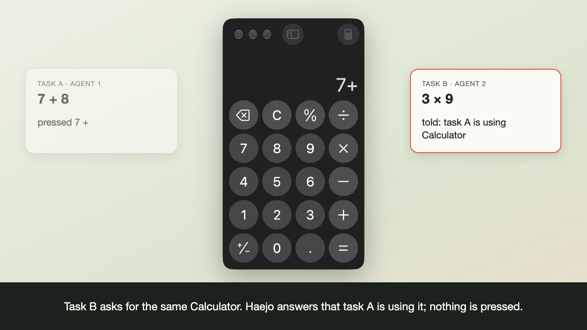

# "Two tasks, one Calculator" clip — 2026-11-16

`docs/assets/demos/agents-take-turns.mp4` (1280×720, 20.3 s, 0.18 MB) and its
poster show two tasks working on one Calculator that stays behind the app in
use. Shot with the installed Haejo 1.0.4 (`955af0f`) on macOS 27.2.1.

[](assets/demos/agents-take-turns.mp4)

## What the clip shows

| Part | Source |
|---|---|
| Calculator window | Real captures of the window by the signed helper, one after each call, while another app was in front |
| The two cards, the caption, the arrangement | Composed by `render_turns.py` from the shoot's summary: what each task had done when the capture was taken |
| "agent 1", "agent 2" | Two Haejo tasks started by the shoot script, one command at a time. No model ran |

Frames are held and cut: captures after each step, composed. It is a sequence
of stills, not continuous screen video.

## The calls and what was recorded

`sites/haejo/film/turns-evidence.json` is the summary of the shoot that made
the published clip. It holds no screen contents, and an app outside
`com.apple.*` appears as `other-app-1`.

| Frame | Call | Result | App in front, before → after |
|---|---|---|---|
| a-7, a-plus | Task A: `haejo run` click 7, then + | exit 0 | Safari → Safari |
| b-told | Task B: `haejo run` click 3 | exit 1, `target_busy` naming task A, with the hint sentence, after 5.6 s; nothing pressed (the display still reads 7+) | Safari → Safari |
| a-8, a-equals | Task A: click 8, then = (display checked: 15) | exit 0 | Safari → Safari |
| b-3 | Task A ended; Task B: the same click 3 again | exit 0, 0.8 s after A ended | Safari → Safari |
| b-times, b-9, b-equals | Task B: ×, 9, = (display checked: 27) | exit 0 | Safari → Safari |

Calculator was never the app in front. B's first call ran with the default
wait; a click ends at its own input deadline, which came before the 10 s wait
in line ([parallel execution](parallel-execution.md#waiting-in-line)).

## Reshooting

Quit Calculator first; the script starts its own behind the app in front and
quits it at the end.

```bash
S=$(mktemp -d)
python3 sites/haejo/film/shoot_turns.py --out "$S"/shoot
.venv/bin/python sites/haejo/film/render_turns.py --shoot "$S"/shoot --out "$S"/clip
cp "$S"/clip/agents-take-turns.* docs/assets/demos/
cp "$S"/shoot/evidence.json sites/haejo/film/turns-evidence.json
```
