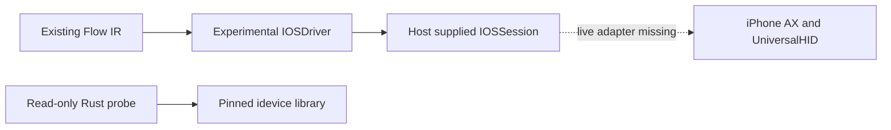

# iPhone target spike and execution verification

This is a development spike on `spike/ios-poki-20261106`, not shipped iPhone
automation. The Python adapter is exercised with transport fixtures. The Rust
probe compiles pinned upstream HID APIs and performs read-only usbmux discovery.
A native CoreDevice/DTX AX probe read a real root element/Label through
MobileDevice lockdown and confirmed HID PING/display info. Its separate owned
counter qualification mode stopped on a pre-input PID mismatch, then the device
became unavailable. A general live accessibility snapshot `IOSSession` is
**not implemented**. No tap was
sent to a physical phone in this work.

## Sources and licensing

The user-provided brief is `~/handoff/poki-ios-brief-20261106.md`. It describes
POKI's architecture and identifies POKI as AGPL-3.0. Its repository returned 404;
the linked documentation returned 403 during this investigation. No POKI code
was obtained or copied. Details such as the reported lost-touch cohort, launch
delay and floating-bar behavior remain claims from that brief, not measurements
reproduced by Tacto.

The independently inspected upstream is [jkcoxson/idevice](https://github.com/jkcoxson/idevice),
fixed at `89702099f4d7552f704f93b4526756abda319ceb` (crate 0.1.68).
Its [license file](https://github.com/jkcoxson/idevice/blob/89702099f4d7552f704f93b4526756abda319ceb/LICENSE.txt)
and Cargo metadata state MIT. `spike/ios-idevice/upstream.json` records the license
digest; Cargo.lock fixes transitive dependencies. No idevice source is vendored.
Distribution of a future bundled bridge must retain the applicable dependency
notices; this spike is not a distribution or deployment of that bridge.

The separate [AX service probe](../spike/ios-ax-bridge/README.md) includes fourteen
MIT files from `sunghyun-k/iphone-use`, pinned to
`6bf94902f1c30aac712ae594a9a3a08136157a48`, with hashes and full copyright notice.
This reference is independent of POKI. Thirteen files are unmodified; the
CoreDevice usage-assertion gate is adapted to require actual fulfillment and
reject an ended lease. Its original and adapted hashes are retained. The default
probe does not expose input; `--owned-fixture` is an explicit development mode
limited to the nonce-bound owned counter, not arbitrary private selectors.

The pinned source exposes `UniversalHidServiceClient` under `display_stream`,
plus usbmux and RemoteXPC services. Its tree did not expose a ready no-WDA AX
snapshot client. Generic DVT/XCTest support is not evidence that this missing
client exists or that a POKI-specific protocol is available. The proposed AX
service, serialization, readiness and foreground-app queries need a separately
verified transport implementation before physical input can be enabled.

## Target and adapter contract

Existing Flow schemas keep their string `target`. The spike uses:

```text
ios://00000000-0000000000000000/com.example.OwnedCounter
```

Both device and bundle ID must be explicit. The identifier above is a
placeholder. There is no default-to-first-phone behavior. The normal CLI
refuses an iOS target before constructing a macOS driver; it does not guess a
transport or fall back to the Mac's foreground app.



`tacto.ios_driver.IOSSession` requires an already-open connection with
`read_snapshot`, `tap_once` and `close`. The host must independently read actual
device ID, foreground bundle, connection epoch, orientation, lock/modal state,
viewport and AX element identities. It must not echo the requested app or infer
that setup is complete from a successful socket connection. `input_ready`
defaults false and modal state defaults unknown. Pairing, Developer Mode, UI
Automation, DDI and Xcode setup are not performed automatically.

`IOSDriver` accepts portrait AX observations and explicit host-authorized taps
at the center of a live, enabled, hittable element. It binds device/app/connection,
checks node and text budgets, and re-reads the full snapshot after authorization
and before sending. A changed snapshot, reconnect, lock, modal, unsupported
orientation, missing authorization or cancellation refuses input. Geometry is
converted from viewport points to UniversalHID's 0–65535 space; it is not a
generic screenshot coordinate executor.
The snapshot-to-HID handoff is not an atomic focus transaction. A real bridge
must measure app switches/user interference during that interval; the current
checks do not establish uninterrupted foreground ownership.

The supplied session remains open through post-touch observation and is closed
only after replay returns. The adapter does not open a new connection per tap,
automatically reconnect, or resend an uncertain write. Native transport must
also preserve its internal HID/RSD handles through that lifetime and implement
bounded reads/writes; a blocking custom transport is not interrupted by this
Python contract's cooperative clock.

For a host-provided session, the entry point is:

```python
from tacto.ios_driver import run_ios_spike

# `session` and the per-element authorization callback are trusted host inputs.
# This example does not instantiate a live bridge.
report = run_ios_spike(flow, session, authorize_tap=authorize_owned_counter)
```

The entry point allows 1–100 explicit `read`/`click` steps with structured
postconditions and reversible read/ephemeral-write contracts. Model judgment,
loops, skip predicates, consequential commits, clipboard/text entry, app launch,
OCR fallback and landscape input remain outside this spike. A direct lower-level
tap returns a dispatch receipt, not a verified Flow result.

## Evidence and time

| Receipt field | Meaning | Does not prove |
| --- | --- | --- |
| `sent=true` | Transport reports a complete host write | Device ACK, delivered touch or task success |
| `sent=null` | Write/reply outcome is unknown | Cancellation or absence of input |
| `screen_changed=true` | Fresh bound AX snapshot fingerprint differs | The requested outcome or causal attribution |
| `screen_change_verified=true` | Previously false Flow predicate is true on a changed fresh snapshot | Saved files, external delivery or human-input preservation |

An unchanged or unrelated screen is not success. A tap whose result predicate
is already true is refused before input. Unknown writes keep input blocked even
if later observations happen to match. Existing `DurableDispatchDriver` can wrap
this driver; its same-directory restart barrier is tested after a lost touch
reply. It remains the host's responsibility to retain the same run directory;
creating a fresh one is not reconciliation.

`ScreenProgressClock` resets only on a changed snapshot fingerprint, not on a
model response or repeated read. IOSDriver's same-screen budget defaults to ten
seconds (host selectable up to 120). The readback call also has an independent
hard deadline. A changed screen can reset the progress clock but cannot extend
that call's hard deadline. These clocks do not add retries or preempt a blocked
transport operation.

Screen fingerprints exclude AX handles, internal identifiers, hit-test metadata,
connection epochs and enumeration order. Those are still checked separately as
input identity; their churn cannot masquerade as screen progress. A failed
observation or logical session close invalidates old indices, including reads.
If transport close fails, the report preserves tap/verification receipts and
returns `ok=false`, `session_closed=false` and a normalized cleanup error.

## Improvements to existing execution

- `Candidate` and `GeneralResult` can carry trusted `human_intervened` and
  `initial_constraints` metadata. An explicitly assisted/unknown-intervention
  candidate is rejected by candidate creation/promotion and the flag is persisted.
  This is a gate on host-reported evidence, **not a new human-input detector**.
  Legacy recordings without audit metadata retain their prior semantics and are
  not newly certified as autonomous.
- Candidate records receive a key over the exact request, target, target identity
  and canonical initial constraints. A different request (including whitespace),
  constraint type/value or target does not merge its repeat count. This is
  candidate grouping metadata; it does not implement a new runtime route selector
  or enforce arbitrary constraints against the actual phone. Existing promotion
  checks and per-step bindings still apply; repeat count never grants promotion.
- Batch results include zero-based `failed_step`, `remaining_steps` including the
  failed step, and `next`. Auto-repair suffix indices map back to the full Flow.
  An unlocalized exception reports null indices instead of guessing.
  `next.action=inspect_receiving_state` and `automatic_resume=false` are advisory,
  not an executable resume cursor. Buffered later jobs still stop after failure.

The existing host-receipt/journal design already separates dispatch from
consequential completion and refuses unknown retransmission. It was reused,
not replaced with a screen-change heuristic.

## Deferred design and physical qualification

POKI-style negative claims need a task-specific evidence contract: for example,
an absent-item claim should require authorized bounded scrolling to a verified
end, two stable viewport fingerprints and a fresh search. At most one unsupported
claim should return to read-only exploration, without resetting the step budget
or resending input. This is a design proposal only. General planner behavior is
not changed: the current APIs do not supply a universal proof of scroll end or
absence, and an app may virtualize content outside the AX tree.

Read-only local discovery found a paired, available physical iPhone. usbmux
enumerations varied between queries; multiple transport rows can identify the
same phone, so the probe reports unique identifiers and connection counts
separately without printing identifiers. This is not proof of Developer Mode, DDI, UI Automation, accessible
screen content, or successful input. Simulators are not physical evidence.

### Remote device readiness: june-mba (2026-11-06)

A retry reached `june-MBA.local` over SSH. Read-only CoreDevice queries found
one physical iPhone 15 Pro running iOS 27.2, paired with Developer Mode enabled.
Xcode 27.2 is installed. The active discovery transport was `localNetwork`;
USB enumeration contained zero iPhone rows, so this does not verify a USB cable
connection. Simulators were excluded from physical-device counts.

The lock query reported `passcodeRequired=false` and `unlockedSinceBoot=true`.
These fields do not certify UI Automation authorization or AX input readiness.
DDI metadata was compatible and `isUsable=true`, while refreshed device discovery
still reported `ddiServicesAvailable=false` and `tunnelState=disconnected`.
The query explicitly used `--no-auto-mount-ddis`; no DDI mount was requested.
A compatible DDI and an active developer service are separate readiness facts.

The installed signed Tacto launched Accessibility Inspector and read its macOS
AX controls. Its Device Target list exposed no children; iPhone AX content was
not obtained. A window capture was refused with `window_missing_or_ambiguous`
for its untitled window. No phone tap, app installation, WDA setup, or deployment
was performed. This is readiness evidence, not the AX/tap qualification below.
Device identifiers and personal content are excluded from the validation record.

The live transport should report discovery, pairing, lock, tunnel/DDI service,
AX readability, and input authorization independently. It should require an
explicit device/transport binding and qualify USB and network paths separately;
a failed network service must not silently switch the target or resend a tap.

### Follow-up: native service attempt and peer review

After authorization to continue physical qualification, explicit
`ddiServices --auto-mount-ddis` returned exit 0 and compatible metadata.
Subsequent discovery still reported no DDI services and a disconnected tunnel;
the metadata command's success does not establish a mounted DDI or live service.
A development-only binary was copied to a private temporary directory on
june-mba and executed without replacing/installing Tacto. Its CoreDevice usage
assertion completed, but `createservicesocket` for the AX lockdown shim failed:
the system could not establish a connection to the device. No focus movement,
AX screen content, HID input, phone app installation or fixture interaction
occurred in that initial attempt. USB connection and an unlocked screen were
requested from the user. This initial failure did not establish that the
CoreDevice HID/display services were unavailable.

The Python `IOSAXProbe` wrapper bounds subprocess communication and response
sizes, kills a hung child, normalizes backend errors, and never reconnects a
failed session. It intentionally does not implement `IOSSession` or advertise
touch capability. The owned HTTP counter fixture is implemented and tested
locally; repeated events increase its independent receiving count rather than
being hidden by deduplication. Its browser-reported trusted flag cannot prove
phone identity or absence of human intervention. Neither fixture tests nor a
capabilities query count as physical AX/tap validation.

Peer implementation review also identified that USB lockdown shims may not be
forwarded by CoreDeviceService. The probe therefore has separate explicit
`mobiledevice-lockdown` and `coredevice-tunnel` modes with no automatic fallback. Both
paths retain their service ownership; the native loop explicitly cleans up at
EOF. The host environment excludes DYLD/DEVELOPER_DIR overrides and native
framework loads require Apple signatures. Usage assertions may change tunnel
and power state, so pre/post device metadata remains part of qualification.

Muxa peer review agreed on the single CoreDeviceService path and identified
constraints that must be resolved before wiring the strict fixture driver to a
live session:

| Fact | Required live evidence / unresolved issue |
| --- | --- |
| Current app | Focus-token PID mapped to the selected app's process; requested bundle is not evidence. |
| Lock state | Lock metadata is not a current-unlocked attestation; app-focused evidence must be explicit. |
| Orientation | Current getdisplayinfo orientation is read separately; panel orientation alone is insufficient. |
| Frame / hittability | AX attributes may be absent; focus-box measurement needs screen capture and local stability checks. |
| Snapshot refresh | Full focus sweeps can scroll or change tokens; they are not pure reads or reliable exact-identity preflight. |
| Readiness | Host authorization and service availability must be distinguished from device permission. |
| HID completion | HTTP/2 PING can prove transport progress, not a device touch ACK or requested result. |

Do not fill unknowns with convenient booleans or lower existing input checks to
make the probe run. A later live contract needs separate AX/HID identities,
target-specific preflight, and recorded provenance for measured facts. An
uncertain partial gesture also needs a bounded release-only cleanup policy;
the isolated owned-counter mode now implements it. Rust idevice remains discovery-only
so a second device-side RSD peer cannot displace the host's remoted connection.

### Latest physical progress and unresolved gate

The explicit MobileDevice lockdown path succeeded with 45 AX capabilities and
`deviceFetchSpecialElement:0` plus a non-null `Label` read. No whole-tree claim
is made. Despite that path's earlier `usb-lockdown` name, CoreDevice reported
`localNetwork` and USB enumeration had no iPhone rows; the API was renamed
`mobiledevice-lockdown` so it does not imply a verified cable connection.

The signed installed Tacto opened DeviceHub and pressed its observed View
Screen control. Afterward CoreDevice reported `tunnelState=connected` and
`ddiServicesAvailable=true`; process enumeration succeeded. The AX shim socket
request still failed, but separate CoreDevice deviceinfo and UniversalHID
connections succeeded, including a HID HTTP/2 PING without any touch report.
`getdisplayinfo` actually returned current device orientation `portrait`,
non-flat orientation `portrait`, panel orientation `rot0`, and a 1179×2556
display. These current-orientation fields are stronger than the earlier
reference's panel-only inference, and are explicitly checked in qualification.

A temporary HTTP fixture server ran on the host LAN address. devicectl opened
its nonce-bound page in Safari and supplied the expected PID from that launch
result, not a handwritten PID. Prepare-only qualification stopped because a
focus token's PID differed from that expected PID. The cause (system element,
WebContent, lock/focus change, or another case) is unresolved; no PID check was
relaxed and no touch was sent. A later MobileDevice service attempt failed,
DeviceHub was no longer running, and discovery reported tunnel `unavailable`,
no transport and no DDI services. The cause of that disconnect is unknown.

Before stopping the temporary server, its independent receiving state was
`count=0`, with no event sequences or pointer types. The server was stopped and
zero native probe workers remained. Device IDs, page token, PID values and AX
content remain in private temporary evidence only, not versioned records.

The implementation and peer review now cover a one-gesture qualification path:
owned heading/counter/PID, measured focus-box geometry and local stability,
fresh portrait display info, two contact samples plus one release on the same
HID connection, then transport PING, bounded HTTP receiving poll and AX counter
readback. A durable exclusive marker is fsynced before input; reuse starts no
new worker. A partial gesture allows at most one release-only cleanup. Unknown
input never retries; a confirmed pre-dispatch refusal is `not_started` while
the marker stays blocked. Reply-loss/partial-write tests are injected I/O tests,
not physical fault-injection evidence. Human-intervention audit and promotion
remain disabled for this qualifier. The actual `0 → 1` and device-disconnect
tests still require a connected, unlocked phone and resolution of the PID gate.

The next physical qualification needs a verified no-WDA AX transport, then:

1. Explicitly select that phone and a harmless owned counter page/app; verify
   foreground app, portrait geometry, no modal/lock and input readiness from fresh
   observations. Keep personal apps and data outside the fixture.
2. Read its AX tree and unique counter/button identities, send exactly one tap,
   keep the same HID connection alive, and read `0 → 1` with an independent
   receiving counter. Record input count, connection epoch and receipt stages.
3. Inject post-write reply loss and disconnect; inspect receiving state and prove
   no second touch, including after a new worker uses the same journal directory.
4. Measure launch settling, bottom-bar hit areas, Wi-Fi/USB behavior and user
   interference. Preserve failures and unknowns. Do not adopt the brief's delay or
   loss figures as Tacto guarantees. Never auto-accept Allow Paste.

No WDA/helper app was installed, no physical tap was sent, and no push or
production deployment is part of this work. Physical AX → one tap → receiving verification
remains required before calling iPhone execution supported.

## Changed files

- `tacto/ios_driver.py`: explicit iPhone target/session, snapshot bounds, one-tap
  receipts, same-screen budget and checked spike replay.
- `tacto/ios_ax_probe.py`, `spike/ios-ax-bridge/`: native no-WDA service probe,
  bounded subprocess boundary, pinned MIT notices, and owned receiving fixture.
- `tacto/protocol.py`, `tacto/flow.py`, `tacto/cli.py`: narrow iOS readback contract,
  pre-existing-result refusal, and no implicit macOS fallback.
- `tacto/execution_summary.py`, `tacto/flow_batch.py`: interruption metadata and
  auto-repair suffix index mapping, without automatic resume authority.
- `tacto/general.py`, `tacto/promote.py`: host intervention/context metadata and
  exact-context candidate keys/grouping.
- `spike/ios-idevice/{Cargo.toml,Cargo.lock,src/main.rs,upstream.json,validation.json,README.md,.gitignore}`:
  pinned MIT dependency, read-only probe and provenance.
- `tests/test_ios_driver.py`, `tests/test_poki_execution_guards.py`,
  `tests/test_flow_batch.py`: fixture/readback, journal, promotion and batch tests.
- `tests/test_ios_ax_probe.py`, `tests/test_ios_ax_probe_native.py`,
  `tests/test_ios_counter_fixture.py`: process faults, native request boundaries,
  source provenance and receiving-count tests; no physical input.
- `tests/test_ios_owned_counter.py`, `tests/test_ios_gesture_native.py`: durable
  qualification barriers and native partial-gesture/release/PING fault tests.
- `README.md`, `docs/capabilities.md`, this document: scope and qualification.
