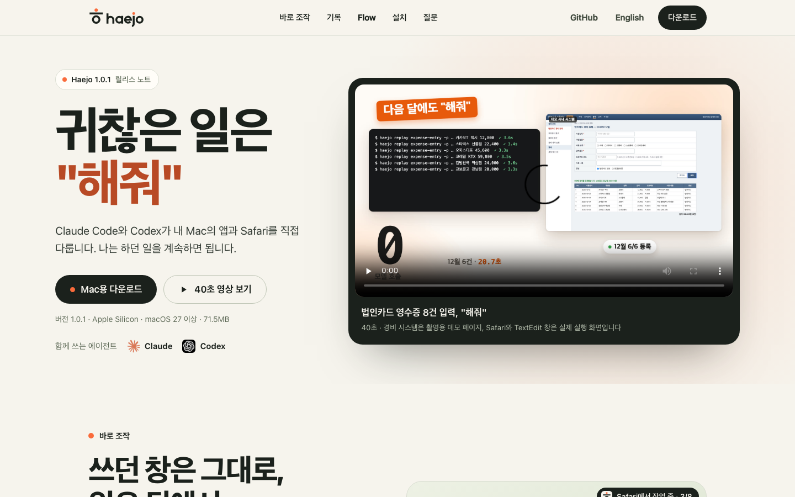

# Haejo 랜딩페이지



Haejo의 랜딩페이지입니다. 한국어(`/`)와 영어(`/en/`) 홈, 그리고 측정 결과 페이지
(`/benchmarks/`, `/en/benchmarks/`)로 이루어진 정적 HTML입니다. 2026-11-13에 1.0 기준으로
전면 개편했습니다.

홈은 다음 순서입니다.

1. **첫 화면**: "귀찮은 일은 해줘", 한 줄 약속, 다운로드 버튼, Claude·Codex, 40초 영상.
   영상은 법인카드 8건을 데모 경비 시스템에 입력하고, 실행 기록으로 확인하고, 저장한 Flow로
   다음 달 6건을 모델 호출 없이 다시 입력합니다([촬영 기록](../../docs/haejo-film-2026-11-10.md)).
2. **바로 조작**: 웹 작업이 내 Safari에서, 쓰던 앱 뒤에서 진행되는 방식과 조작마다 고르는
   세 가지 방법, 탭·파일 첨부·페이지 스크립트·Mac 앱. 수치는
   [Safari 측정표](../../docs/safari-capability-matrix.md)에서 옵니다. 창 그림은 CSS로 그린 설명용 그림입니다.
3. **기록**: 앱의 실행 기록 화면과 기록에 담기는 것([기록 안내](../../docs/access-logging.md)).
4. **Flow**: 영상에서 쓴 `expense-entry` 7단계와 12월 6건 재생의 실측 시간(합계 20.7초, 모델 호출 0회).
5. **설치**: 내려받기, 권한 두 가지, 첫 작업. 첫 설정 창 화면을 함께 보여 줍니다.
6. **자주 묻는 질문**과 바닥글.

성능 비교(2026-10-14 동일 조건 3쌍), 11단계 Flow 재생, Safari 웹 조작 측정은 홈에서 빼
`benchmarks/` 페이지에 모았고, 측정 조건은 항목마다 한 번씩 적습니다. 원본은
`dist/assets/benchmark-summary.json`과 [측정 조건 기록](../../docs/haejo-matched-comparison-2026-10-14.md)입니다.

별도 Chromium에서 촬영한 웹 예제와 TextEdit·Finder·계산기·테스트 앱 녹화는 홈에서 내리고
`docs/assets/demos/`로 옮겼습니다. 저장소 [README](../../README.ko.md)가 계속 연결합니다.

## 앱 화면 다시 만들기

실행 기록과 첫 설정 화면은 설치된 앱이 창을 띄우지 않고 그린 것입니다. 기록 화면의 작업은
`activity_fixture.py`가 만드는 예시 기록이며 개인 기록을 읽지 않습니다.

```sh
python3 sites/haejo/activity_fixture.py /tmp/haejo-activity-fixture
/Applications/Haejo.app/Contents/MacOS/HaejoSetup --activity-snapshot /tmp/haejo-activity-shot \
  --activity-fixture /tmp/haejo-activity-fixture -AppleLanguages '(ko)' -AppleLocale ko_KR
/Applications/Haejo.app/Contents/MacOS/HaejoSetup --snapshot /tmp/haejo-setup-shot --standalone --connected \
  --brand-assets docs/assets -AppleLanguages '(ko)' -AppleLocale ko_KR
```

`app.png`(2120×1400)를 `dist/assets/haejo-activity.png`로, 오른쪽 상세 영역을 잘라
`haejo-activity-detail.png`(좁은 화면용)로 씁니다. `setup.png`는 위 884px을 `haejo-setup.png`로,
권한 카드 부분을 `haejo-setup-permissions.png`로 씁니다.

## 로컬 미리보기

저장소 루트에서:

```sh
python3 sites/haejo/serve.py
```

브라우저에서 http://127.0.0.1:8787 을 엽니다. 종료는 Ctrl+C입니다.
빌드 단계나 npm 의존성이 없습니다. 로컬 서버에는 macOS/Linux의 Python 3.9 이상이 필요합니다.

다른 기기에서 보려면 서버를 실행하는 컴퓨터의 LAN 주소를 지정합니다.

```sh
python3 sites/haejo/serve.py --host <LAN-IP> --port 8787
```

같은 네트워크에서 `http://<LAN-IP>:8787`로 접속합니다.
서버는 `dist/`의 정적 파일만 제공하며 폴더 목록·숨김 경로·심볼릭 링크는 제공하지 않습니다.
CSP·referrer·프레임·MIME 보호 헤더를 함께 보냅니다.
영상은 HTTP byte range로 탐색할 수 있습니다.
HTML·CSS·JS·SVG·JSON은 gzip을 협상하고, ETag가 같으면 본문 없이 304를 반환합니다.
파일 변경을 매번 재검증하므로 같은 이름의 새 로고나 스크립트가 오래 캐시되지 않습니다.
이 명령을 직접 실행한 경우 Ctrl+C로 종료합니다.

## 파일

- `dist/index.html`, `dist/en/index.html`: 한국어·영어 홈
- `dist/benchmarks/index.html`, `dist/en/benchmarks/index.html`: 측정 결과
- `dist/style.css`: 손으로 쓴 스타일시트 하나. 반응형(360–1600px), 키보드 포커스, reduced motion
- `dist/app.js`: 좁은 화면의 메뉴 접기와 요청 문장 복사. 스크립트 없이도 모든 내용이 보입니다
- `dist/assets/film/`: 40초 영상(한국어·영어 MP4·WebM·포스터)
- `dist/assets/haejo-activity*.png`, `haejo-setup*.png`: 앱 화면
- `dist/assets/expense-entry.flow.json`, `benchmark-summary.json`: 페이지가 연결하는 원본
- `dist/assets/`: 외부 폰트 없이 그린 SVG 로고·워드마크·배너·아이콘
- `film/`: 영상 촬영(`shoot_expense.py`, `shoot_everyday.py`, `shoot_workflow.py`)과 렌더링(`render.py`, `film.html`), 데모 경비 화면
- `activity_fixture.py`: 실행 기록 화면용 예시 기록
- `render_native_examples.py`, `record_browser_demos.py`, `record_everyday_browser_demos.py`, `annotate_recordings.py`: `docs/assets/demos/`의 녹화 제작
- `serve.py`: 정적 파일 전용 LAN 서버
- `qa.py`: Playwright 기반 구조·링크·키보드·반응형·JavaScript 없는 화면 검사

폼, 계정, 분석 추적, 서버 API는 없습니다. 폰트·스크립트·이미지는 외부 CDN에 요청하지 않으며 시스템 폰트와 같은 사이트의 파일만 사용합니다.
방문자의 값을 저장·전송하는 기능은 없습니다. 정적 호스팅 사업자는 별도로 접속 로그를 남길 수 있습니다.
페이지는 CSP로 외부 연결을 차단하고 외부 링크에 referrer를 보내지 않습니다. 인라인 스크립트·스타일·이벤트 핸들러를 쓰지 않습니다.

## 정적 호스팅

`dist/`의 내용을 정적 호스트의 공개 루트에 그대로 올리면 됩니다.
상대 경로를 사용하므로 하위 경로에서도 제공합니다. 별도의 rewrite 설정은 필요하지 않습니다.
공개 배포 시 실제 URL에 맞춰 canonical·Open Graph URL/공유 이미지를 설정할 수 있습니다.

공개 사이트: https://open330.github.io/haejo/ (영어 /en/). main의 `sites/haejo/dist`가 바뀌면
`.github/workflows/pages.yml`이 GitHub Pages로 배포합니다. 예전 주소 `open330.github.io/tacto/`는
조직 사이트의 안내 페이지가 새 주소로 넘깁니다.

이전 이름·명령·권한의 호환성은 [전환 안내](../../docs/haejo-branding.md)를 참고하세요.


## 브라우저 회귀 검사

테스트 환경에 Playwright와 Chromium을 준비한 뒤 서버를 실행하고 검사합니다.
Playwright는 QA 도구이며 페이지가 내려받는 의존성이 아닙니다.

```sh
python3 sites/haejo/qa.py --url http://127.0.0.1:8787 --output /tmp/haejo-page-qa
```

네 페이지 각각에서 구조와 섹션 순서, 다운로드 주소, hreflang·언어 전환, CSP, 이미지 alt·크기,
내부 링크, 영상 재생 준비, Flow 단계와 원본 JSON의 일치, 측정 수치와 요약 JSON의 일치,
320–1600px에서의 가로 넘침, 좁은 화면 메뉴, 키보드 포커스, reduced motion을 확인하고
한국어·영어 홈의 구조가 같은지 비교합니다. 이미 준비한 axe-core의 `axe.min.js`가 있으면
`--axe /path/to/axe.min.js`로 자동 접근성 검사를 추가합니다.
2026-11-13 개편: 179/179 통과, axe-core 4.13.0 위반 없음(데스크톱, 좁은 화면 메뉴 열림).
검사는 임시 브라우저를 사용하며 개인 브라우저 프로필에 연결하지 않습니다.
자동 검사 통과가 모든 접근성 요구사항의 수동 검토를 대신하지는 않습니다.

## README용 녹화: 포인터 안내 영상 다시 만들기

개발 환경에 `ffmpeg`와 `rsvg-convert`가 있으면 저장소 루트에서 실행합니다.
페이지 사용자는 이 도구를 설치할 필요가 없습니다.

```sh
python3 sites/haejo/annotate_recordings.py
```

`docs/assets/demos/pointer-guide.json`의 대상 위치·동작 순서와 캡처 프레임 변화에
맞춰 안내 표시를 렌더링합니다. 표시 시각은 설명을 위한 재구성이며 실제
마우스 좌표·정밀한 입력 시각을 측정한 값이 아닙니다. 원본 파일은 유지합니다.

## README용 녹화: 브라우저 예제 다시 촬영하기

프로젝트 Python 환경에 Playwright·Chromium과 ffmpeg를 준비한 뒤 실행합니다.
공개 사이트에 접속하므로 네트워크 연결이 필요합니다. 결과 폴더는 새 경로를 사용합니다.

```sh
python3 sites/haejo/record_browser_demos.py --output /tmp/haejo-new-browser-recording
```

`--scenario wikipedia`, `shopping`, `form`으로 한 예제만 선택할 수도 있습니다.
개인 프로필을 사용하지 않으며, 입력·클릭·선택은 Haejo Flow로 실행합니다.
촬영을 위한 안내 포인터와 동작 전후 대기 시간이 있으므로 실행 시간 벤치마크로 쓰지 않습니다.
